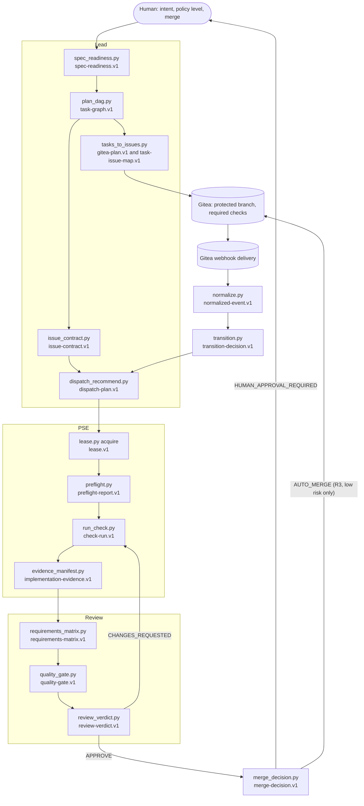

# Skill Lab architecture

This repository builds a portable set of agent skills that bring the engineering-team design in
the [report](research/engineering-team-report.md) (Lead, PSE and Review over a Gitea control
plane, Spec Kit delivery, JSON evidence, policy-mediated merge) to the **Zed Agent on Ollama**
first, and to **Claude Code** and **Codex** second. It also builds the **lab** that validates,
benchmarks, scores and installs those skills.

The binding rules are in [CONVENTIONS](CONVENTIONS.md). The reasons for them are in the
[ADRs](adr/README.md). This document shows how the pieces fit.

**State on 2026-10-22.** The foundation is built and tested: the 23 JSON contracts, the shared
library `_skillkit`, and the lab (validate, sync, install, catalog, new, doctor, test, bench with
its runtimes and Jev client, score). The skills themselves are specified (SPEC-001..SPEC-013,
SPEC-201) but not built yet, so `skills/` is empty. Network access to `ollama.com` and
`api.typesafe.ai` is blocked in the build container, and there is no live Gitea server. Every
statement below about a skill script describes the SPEC-201 plan, not existing code.

## Contents

1. [System at a glance](#1-system-at-a-glance)
2. [Components](#2-components)
3. [The skills](#3-the-skills)
4. [The Lead, PSE and Review loop](#4-the-lead-pse-and-review-loop)
5. [The lab pipeline](#5-the-lab-pipeline)
6. [Runtime matrix](#6-runtime-matrix)
7. [Where state lives](#7-where-state-lives)
8. [What is verified where](#8-what-is-verified-where)
9. [How the 12 factors show up](#9-how-the-12-factors-show-up)

## 1. System at a glance

```text
                     HUMAN: product intent · autonomy level (.skill-policy.json) · merges
                                              │
   ┌──────────────────────────────────────────┼──────────────────────────────────────────┐
   │  RUNTIME   Zed Agent (priority) · Claude Code · Codex                                │
   │            Lead profile           PSE profile            Review profile              │
   │                 └─────────────── loads skills from ──────────────┘                   │
   │            .agents/skills/<name>  (Zed, Codex)   .claude/skills/<name>  (Claude)     │
   └──────────────────────────────────────────┬──────────────────────────────────────────┘
                                              │ symlinks
                                              ▼
   skills/<name>/SKILL.md ── numbered steps, one tool call each ──► scripts/*.py  (stdlib)
                                                                       │
                       exactly one envelope.v1 JSON document per call ◄┘
                       (payload = a versioned contract; exit code 0–4)
                                              │
            ┌─────────────────┬───────────────┴──────────┬───────────────────────┐
            ▼                 ▼                          ▼                       ▼
       REPOSITORY        ./.skill-state/            GITEA 28.x               MODEL SERVICES
       specs, tasks,     leases, seen sets,         issues, state/* labels,  Ollama Cloud (default)
       ADRs, task→issue  checkpoints, check logs    deps, PRs, reviews,      Ollama local (gated)
       map (committed)   (local, git-ignored)       checks, protection       Jev (grading only)
                                                         │ signed webhooks
                                                         ▼
                                             gitea-event-normalizer ──► kanban-state-machine
```

The lab sits beside the skills and never ships into them:

```text
   skill-lab/
     contracts/schemas/*.v1.schema.json ──┐
     shared/_skillkit/*.py ───────────────┼── skill-lab sync ──► skills/<name>/scripts/_skillkit/
                                          │                      skills/<name>/assets/schemas/
     lab/  validate · test · bench · score · install · catalog · doctor · new
           runtimes/ (ollama-local, ollama-cloud, claude-cli, codex-cli, replay, Zed emulation)
           jev.py + cassette.py (TypeSafe System One grader)
     benchmarks/criteria/   specs/   docs/   templates/   fixtures/   tests/
```

Three rules hold the picture together:

- **Scripts decide, models orchestrate** ([ADR-0005](adr/0005-deterministic-control-flow.md)).
  Every state change is computed by a deterministic script. The model picks the next step and
  relays JSON.
- **JSON contracts are the only channel** ([ADR-0004](adr/0004-json-contracts.md)). Nothing that
  defines state travels as prose.
- **The boundary is Gitea plus deterministic gates** ([ADR-0008](adr/0008-role-authority-guardrails.md)).
  Runtime profiles and permissions are guardrails only.

## 2. Components

| Component | Location | Responsibility | Spec | State |
|---|---|---|---|---|
| Skills | `skills/<name>/` | One flat folder each: `SKILL.md`, `scripts/`, `references/`, `assets/`, `evals/`, `tests/` | SPEC-001..013 | planned (SPEC-201) |
| Shared library | [`shared/_skillkit/`](../shared/_skillkit/__init__.py) | Envelope, CLI, strict JSON, schema validator, frontmatter parser, redaction, path guards, ids, assertions | [SPEC-100](../specs/100-contracts-skillkit/spec.md) | built (13 files); R1 adds `policy`, `speckit_tasks`, `gitrepo`, `checks`, `gitea` |
| Contracts | [`contracts/schemas/`](../contracts/README.md) | Canonical JSON Schemas (draft 2020-12 subset) | SPEC-100 | 23 built; R1 adds 21 |
| Lab CLI | `skill-lab/bin/skill-lab`, [`lab/`](../lab/cli.py) | validate, sync, install, catalog, new, doctor, test | [SPEC-101](../specs/101-lab-core/spec.md) | built |
| Bench and runtimes | [`lab/bench.py`](../lab/bench.py), `lab/runtimes/` | Run cases on three tiers; Zed emulation; record and replay | [SPEC-102](../specs/102-bench-runtimes-graders/spec.md) | built (tested against local fakes only) |
| Jev client | [`lab/jev.py`](../lab/jev.py), [`lab/cassette.py`](../lab/cassette.py) | Typed noul, score and choice judgments | [SPEC-103](../specs/103-jev-grader/spec.md) | built (fake server only) |
| Scoring | [`lab/score.py`](../lab/score.py), [`benchmarks/criteria/_defaults.json`](../benchmarks/criteria/_defaults.json) | `skill-score.v1` and release readiness | [SPEC-104](../specs/104-scoring-gates/spec.md) | built |
| Release tooling | `lab/release.py`, `lab/containment.py`, `lab/gitea_double.py`, `bin/export-repo` | Release gates, policy containment, Gitea test double, standalone export | [SPEC-201](../specs/201-release-shadow/spec.md) | planned |
| Runtime templates | `skill-lab/config/{zed,claude,codex}/` | Profiles, permissions, cloud-first models | SPEC-201 FR-039 | planned |
| Specs, ADRs, research | [`specs/`](../specs/200-release-roadmap/spec.md), [`docs/adr/`](adr/README.md), [`docs/research/`](research/SOURCES.md) | Intent, decisions, verified facts | [ADR-0013](adr/0013-spec-first-delivery.md) | living |
| External services | Gitea 28.x, Ollama Cloud and local, TypeSafe API | Execution state, inference, grading | — | none reachable today |

## 3. The skills

Twelve skills carry the operating model. A thirteenth, `speckit-development`, was added by SPEC-200
to deliver each release, which makes thirteen in five families (`metadata.family`). The script names
come from SPEC-201's tasks. The contracts marked R1 are added by SPEC-201. Every script emits
`envelope.v1`.

### Roles

| Skill | Spec | Purpose | Scripts | Emits | Consumes |
|---|---|---|---|---|---|
| `lead-architect` | SPEC-001 | Keep intent: check spec readiness, build the task DAG, write issue contracts, recommend dispatch, arbitrate PSE and Review disagreements | `spec_readiness.py`, `plan_dag.py`, `issue_contract.py`, `dispatch_recommend.py`, `arbitrate.py` | `spec-readiness`, `task-graph`, `issue-contract`, `dispatch-plan` (R1), `arbitration-record` (R1), `rendered-document` (R1) | Spec Kit files, `lease-check`, `review-verdict` |
| `pse-implementer` | SPEC-002 | Implement one leased issue and prove it with evidence from executed checks | `preflight.py`, `run_check.py`, `evidence_manifest.py`, `propose_patch.py`, `delivery_plan.py` | `preflight-report`, `check-run`, `patch-proposal`, `mutation-plan` (all R1), `implementation-evidence` | `issue-contract`, `lease` |
| `review-verifier` | SPEC-003 | Rebuild requirements from the spec, compute the quality gate, issue an independent verdict | `requirements_matrix.py`, `quality_gate.py`, `review_verdict.py` | `requirements-matrix` (R1), `quality-gate`, `review-verdict`, `gitea-plan` | `implementation-evidence`, `check-run`, spec and traceability |

### Spec Kit and Gitea

| Skill | Spec | Purpose | Scripts | Emits | Consumes |
|---|---|---|---|---|---|
| `speckit-gitea-taskstoissues` | SPEC-004 | Turn `tasks.md` into missing Gitea issues with dependencies, idempotently | `tasks_to_issues.py` | `gitea-plan`, `task-issue-map` | `tasks.md`, issue list |
| `speckit-gitea-sync` | SPEC-005 | Report drift between `tasks.md`, the map and Gitea; never rewrite the spec | `sync_drift.py`, `comment_plan.py` | `sync-drift-report`, `gitea-plan` | `tasks.md`, `task-issue-map`, issue list |
| `speckit-development` | SPEC-013 | Deliver a feature's `tasks.md` step by step: run checks, mark tasks done only on evidence, converge, request an independent review | `dev_state.py`, `converge.py`, `pr_body.py`, `review_request.py`, `review_local.py`, `review_collect.py`, `delivery_plan.py` | `development-report`, `convergence-report`, `review-request`, `check-run`, `mutation-plan` (all R1) | `review-verdict`, Spec Kit files |

`speckit-development` is invoked as `/speckit-development` in Zed and Claude Code and as
`$speckit-development` in Codex.

### Control plane

| Skill | Spec | Purpose | Scripts | Emits | Consumes |
|---|---|---|---|---|---|
| `kanban-state-machine` | SPEC-006 | Rule on board transitions for the report's 10 states and compute `next_action` | `transition.py`, `labels_plan.py` | `transition-decision`, `gitea-plan` | `normalized-event`, issue and PR state |
| `work-lease` | SPEC-007 | Grant, renew and release exclusive, expiring claims with write-domain overlap checks | `lease.py` | `lease`, `lease-check` (R1) | — |
| `gitea-event-normalizer` | SPEC-008 | Verify, deduplicate and normalise webhook deliveries | `normalize.py` | `normalized-event` | raw delivery and headers |
| `merge-policy-gate` | SPEC-009 | Classify risk from changed paths and decide `AUTO_MERGE`, `HUMAN_APPROVAL_REQUIRED` or `BLOCKED` | `merge_decision.py`, `merge_plan.py` | `merge-decision`, `gitea-plan` | `review-verdict`, `quality-gate`, diff |
| `session-checkpoint` | SPEC-010 | Write and resume compact handoffs (decisions and evidence, never chain-of-thought) | `checkpoint.py` | `session-checkpoint`, `resume-plan` (R1) | branch and lease state |

### Audit and meta

| Skill | Spec | Purpose | Scripts | Emits | Consumes |
|---|---|---|---|---|---|
| `twelve-factor-audit` | SPEC-011 | Score a codebase against the 12 factors with file evidence | `audit.py` | `twelve-factor-scorecard` | target repository |
| `skill-forge` | SPEC-012 | Create, check, benchmark and score new skills with the lab. This is the repository's answer to `/create-skill`, under a name that does not shadow Zed's built-in. Its scripts check skills with the vendored frontmatter parser; running the lab CLI is an optional procedure step when the lab is present ([ADR-0001](adr/0001-two-folder-monorepo.md)) | `forge.py` | `scaffold-plan` (R1) | `SKILL.md`, eval cases |

## 4. The Lead, PSE and Review loop

The loop follows the report's operating model
([§The three-agent operating model](research/engineering-team-report.md#the-three-agent-operating-model),
[§Kanban state machine](research/engineering-team-report.md#kanban-state-machine)). Every arrow
is a JSON document validated against a contract. Every box is a deterministic script.



| # | Step | Role | Script | Reads | Writes | What code decides |
|---|---|---|---|---|---|---|
| 1 | Readiness | Lead | `spec_readiness.py` | `spec.md`, `plan.md`, `tasks.md`, checklists | `spec-readiness.v1` | `ready`, from required sections, ids and traceability |
| 2 | Plan | Lead | `plan_dag.py` | `tasks.md` | `task-graph.v1` | Edges, waves, cycles, write-set conflicts |
| 3 | Issues | Lead | `tasks_to_issues.py` | task graph, map, issue list | `gitea-plan.v1`, `task-issue-map.v1` | Which issues are missing; idempotency keys |
| 4 | Contract | Lead | `issue_contract.py` | spec, task ids | `issue-contract.v1` | Acceptance criteria ids, risk, write domains, ownership |
| 5 | Dispatch | Lead | `dispatch_recommend.py` | task graph, leases, issue states | `dispatch-plan.v1` with `mutation-request.v1` items | What is eligible and what is deferred, and why |
| 6 | Claim | PSE | `lease.py acquire` | lease store | `lease.v1`, `lease-check.v1` | Exclusive claim; overlap refusal |
| 7 | Build and check | PSE | `preflight.py`, `run_check.py` | issue contract, working tree | `preflight-report.v1`, `check-run.v1` | No ambiguity left; checks really ran (log digests) |
| 8 | Evidence | PSE | `evidence_manifest.py` | check runs | `implementation-evidence.v1` | Nothing claimed without an executed check (`CHECK_NOT_EXECUTED`) |
| 9 | Verify | Review | `requirements_matrix.py`, `quality_gate.py` | spec, traceability, evidence, re-run checks | `requirements-matrix.v1`, `quality-gate.v1` | Coverage from the spec, not from PSE's claims; applicable `not_run` fails |
| 10 | Verdict | Review | `review_verdict.py` | quality gate, findings | `review-verdict.v1` | `APPROVE` only with a passing gate, no blockers, nothing unverified, and an independent reviewer |
| 11 | Merge decision | Lead or system | `merge_decision.py` | verdict, gate, changed paths, autonomy level | `merge-decision.v1` | Risk class; policy paths are critical; the level caps the decision |
| 12 | Events | system | `normalize.py`, `transition.py` | webhook delivery, live state | `normalized-event.v1`, `transition-decision.v1` | Authenticity, duplicates, legal transitions, next action |

Every write takes the same path through four layers, and any layer can stop it
([ADR-0005](adr/0005-deterministic-control-flow.md)):

```text
  model proposes         script decides           policy decides            operator decides      Gitea enforces
  ──────────────         ──────────────           ──────────────            ────────────────      ──────────────
  "run step N" or   ──►  preconditions,     ──►   policy.require(action) ──► --apply given?  ──►   branch protection,
  mutation-request       schema, leases           exit 4 if the level is     no: emit the plan,    required checks and
                         exit 1 or 2 on fail      too low or denied          exit 0                reviews, human merge
```

Webhook deliveries drive the board only after verification
([ADR-0012](adr/0012-security-model.md)):

```text
  Gitea ── POST, X-Gitea-Signature ──► normalize.py ────────► normalized-event.v1 ──► transition.py ──► transition-decision.v1
                                       HMAC over raw body     signature_verified,      decide / next     allowed, to_state,
                                       dedupe by delivery id  duplicate, blocking                        required_role
                                                                                            │
                                                                                            ▼
                                                                         labels_plan.py ──► gitea-plan.v1 (state/<name>)
```

At every session boundary a role writes a `session-checkpoint.v1` and its successor runs
`checkpoint.py resume-plan`, which marks the checkpoint stale when the branch head moved. What each
level lets a script actually do is set by `.skill-policy.json` (CONVENTIONS §8): at `shadow` (R1)
every write in this table is a plan or a refusal; at `agent-implementation` (R2) PSE, Lead and Review
write to Gitea and the merge stays human; at `guarded-autonomous` (R3) low-risk PRs auto-merge
through Gitea's "merge when checks succeed".

## 5. The lab pipeline

```text
   change canonical code, a contract, or a skill
                │
                ▼
   ┌────────┐  ┌──────────┐  ┌────────┐  ┌─────────┐  ┌─────────┐  ┌───────────┐
   │  sync  │─►│ validate │─►│  test  │─►│  bench  │─►│  score  │─►│  install  │
   └────────┘  └──────────┘  └────────┘  └─────────┘  └─────────┘  └───────────┘
   vendor       every [V]     unittest    3 tiers on   gates →      links into
   _skillkit    rule, per     for lab     a runtime,   skill-score  .agents/skills
   and schemas  runtime       and skills  graded       release_     .claude/skills
                profile                               ready
```

| Step | Command | Reads | Output | Exits 1 when | Gate |
|---|---|---|---|---|---|
| sync | `skill-lab sync [--check]` | `shared/_skillkit`, `contracts/schemas` | vendored copies; lab-sync payload | `--check` finds drift (`VENDOR_DRIFT`) | G-OFF-02 |
| validate | `skill-lab validate [--runtime zed,claude,codex]` | every skill, its spec, cases, install state | `validation-report.v1` | any error finding; catalog over 50 KB | `static.score`, G-OFF-01 |
| test | `skill-lab test` | `skill-lab/tests`, each `skills/<name>/tests` | counts per suite | a suite failed or errored | `tests.pass_rate`, G-OFF-03/04 |
| bench | `skill-lab bench --tier deterministic,agentic,trigger [--runtime …] [--jev …]` | eval cases, fixtures, runtime, Jev | `benchmark-run.v1`, `benchmark-result.v1` | a graded case failed or errored | `bench.*` gates, G-OFF-05, G-LIVE-01..05 |
| score | `skill-lab score --skill NAME [--strict]` | validation report, tests, latest run, criteria | `skill-score.v1` | not `release_ready` | per-skill release decision |
| install | `skill-lab install [--project DIR \| --global] [--mode copy]` | `skills/` | links or marked copies | `--check` finds drift (`INSTALL_DRIFT`) | — |

Supporting commands: `skill-lab catalog` writes `skills/CATALOG.json`; `skill-lab doctor`
reports the interpreter, layout, install parity, which credentials are set (never their values),
and whether Jev, Ollama Cloud, local Ollama and Gitea answer; `skill-lab new NAME` scaffolds a
skill and its spec that already pass validation. R1 adds `skill-lab policy`,
`skill-lab release check` and `skill-lab/bin/export-repo`.

Two practical notes. Bench without a runtime or a Jev key still runs: deterministic cases are
graded, and agentic and trigger cases are `skipped` with `LIVE_PREREQ_MISSING`, never passed
([ADR-0010](adr/0010-definition-of-success.md)). And `score` counts every validator warning,
including `install.not-installed`, so score a skill after it is installed in the checkout. The final
`install` step is the distribution step, into a user's project or home folder.

## 6. Runtime matrix

| | Zed Agent + Ollama Cloud | Zed Agent + local Ollama | Claude Code | Codex |
|---|---|---|---|---|
| Priority and state | 1; default for every profile in R1 | 2; ships disabled until SPEC-202's L1 gate | after Zed, equal with Codex | after Zed, equal with Claude Code |
| Discovery | `<worktree>/.agents/skills/<name>` (trusted worktrees only) or `~/.agents/skills/<name>`; flat | same | `.claude/skills/<name>/SKILL.md` | `.agents/skills` from cwd up to the repository root; symlinks followed |
| How the model sees skills | Catalog of names and descriptions in the system prompt (50 KB budget); the `skill` tool loads the body in a `<skill_content>` envelope that names the directory | same | its skill loader | its skill loader |
| Invocation | model-invoked (permission prompt unless allowed) or `/name` | same | `/name` | `$name` |
| Skill folder for script paths | from Zed's skill envelope | same | `.claude/skills/<name>` | `.agents/skills/<name>` |
| Inference | a signed-in local daemon at `http://localhost:11434` serving `-cloud` models (recommended; one Zed provider then reaches local and cloud models), or `https://ollama.com` with `OLLAMA_API_KEY` | `http://localhost:11434` | Claude models | Codex models |
| Structured outputs | none; scripts produce JSON, model JSON is validated and repaired at most twice | `format` available, not relied on | not needed (scripts produce JSON) | not needed (scripts produce JSON) |
| Context | model maximum | 32,768, set explicitly (Zed defaults to 4096) | model maximum | model maximum |
| Authority controls | Zed profiles, global `tool_permissions`, optional OS sandbox | same | `.claude/settings.json` permissions | `AGENTS.md`; sandbox modes |
| Benchmarked as | `--runtime ollama-cloud`, which calls `https://ollama.com` directly (label `ollama-cloud-zed-emulation`) | `--runtime ollama-local` (`num_ctx` 32768) | `--runtime claude-cli` | `--runtime codex-cli` |

Bench reproduces Zed's skill catalog and `<skill_content>` envelope byte for byte, from Zed's
`system_prompt.hbs` and `render_skill_envelope`, but not Zed's tool loop, so its token counts are a
lower bound for a real Zed session ([ADR-0003](adr/0003-ollama-inference-and-context-budget.md)).
Spec Kit's own skills use the same discovery folders: `/speckit-*` in Zed and `$speckit-*` in
Codex ([SOURCES.md](research/SOURCES.md#codex-and-claude-code-skills)).

## 7. Where state lives

| State | Where | Written by | Contract |
|---|---|---|---|
| Product intent, specs, plans, tasks | target project's `specs/<feature>/` (Spec Kit) | Lead, humans | Spec Kit Markdown |
| This repository's own specs and decisions | `skill-lab/specs/`, `skill-lab/docs/adr/` | humans, build sessions | spec template, MADR |
| Task-to-issue mapping | committed JSON in the target project | taskstoissues | `task-issue-map.v1` |
| Board state, assignments, dependencies, PRs, reviews, checks | Gitea | scripts through the guarded client; humans | `state/<name>` labels, Gitea API |
| Autonomy level | `.skill-policy.json` at the project root (human only) | humans | `autonomy-policy.v1` (R1) |
| Leases, webhook seen set, checkpoints, check logs | `./.skill-state/` or `--state-dir` (git-ignored) | work-lease, normalizer, checkpoint, `run_check` | `lease.v1`, `session-checkpoint.v1`, `check-run.v1` |
| Benchmark runs | `skill-lab/benchmarks/runs/<run_id>/` (git-ignored) | bench | `benchmark-run.v1` |
| Release evidence and cassettes | `skill-lab/specs/20N-*/evidence/` (redacted) | release tooling | `release-gate-report.v1` (R1) |
| Secrets | environment variables only | the operator | never written anywhere |

Nothing is stored in a conversation. A replacement session rebuilds its context from the repository,
Gitea and its checkpoint (report
[§Context engineering and long-horizon continuity](research/engineering-team-report.md#context-engineering-and-long-horizon-continuity)).

## 8. What is verified where

| Property | Mechanism | Where it runs | State |
|---|---|---|---|
| `SKILL.md` loads in all three runtimes | `frontmatter.*`, `body.*`, `zed.*` rules; catalog budget | `skill-lab validate` | enforced (no skills yet) |
| Vendored code and schemas are current | `sync --check`, `vendor.*` rules | `sync`, `validate` | enforced |
| Stdlib only, Python 3.9 compatible | `scripts.*` rules; source-rule tests; real 3.9 in CI | `validate`, `skill-lab test`, CI | enforced statically; 3.9 run planned (G-OFF-03) |
| One envelope, exit codes 0–4, compact errors | `envelope.run_script`; deterministic grader checks `ok` against the exit code | unit tests, bench | enforced |
| Contracts are closed, subset-only and self-consistent | `test_contracts.py`, differential tests against `jsonschema` | `skill-lab test` | enforced |
| Illegal states are unrepresentable | schema invariants (APPROVE, AUTO_MERGE, quality gate, skill score) | every validation | enforced |
| Each script behaves as specified | skill unit tests and ≥ 4 deterministic cases per skill | `test`, `bench --tier deterministic` | planned per skill |
| A model can follow the skill | agentic tier with schema checks, assertions and Jev judgments | `bench --tier agentic` live | not run (network blocked) |
| Requests route to the right skill | trigger tier over the whole catalog | `bench --tier trigger` live | not run (network blocked) |
| "Not run" never counts as passed | score and bench semantics; `release check` | `score`, `release check` | enforced (score, bench); planned (release check) |
| Nothing mutates at `shadow` | `skill-lab policy containment` with the Gitea double's request log | release gate G-OFF-07 | planned |
| Reviewer is independent of the author | session ids and `Claude-Session:` trailers; per-role Gitea identities in R2 | `review_verdict.py`, `review_collect.py` | planned |
| Webhooks are authentic and new | HMAC-SHA256 with constant-time compare; delivery dedupe | `normalize.py` tests | planned |
| Secrets never leak | redaction tests; doctor tests; export secret scan | `skill-lab test`; `export-repo` | enforced (lab); planned (export) |
| Every requirement is traced and verified | `spec.*` rules; `validate --specs` | `validate`, G-OFF-08 | enforced for skill specs; planned for lab and release specs |
| The exported repository stands alone | `export-repo --check`; gates from the export root | G-OFF-10, G-OFF-11 | planned |
| Merges obey protection and policy | Gitea branch protection; merge gate; human merge | Gitea, humans | external |
| Jev thresholds mean what they claim | calibration on labelled data | — | gap ([ADR-0007](adr/0007-jev-calibrated-grader.md)) |

The open gaps are collected in the [ADR index](adr/README.md#open-compliance-gaps).

## 9. How the 12 factors show up

The design applies [12-factor agents](https://github.com/humanlayer/12-factor-agents/blob/main/README.md)
to coding-agent skills. The `twelve-factor-audit` skill scores other codebases the same way.

| Factor | Where it shows up here |
|---|---|
| [1](https://github.com/humanlayer/12-factor-agents/blob/main/content/factor-01-natural-language-to-tool-calls.md) Natural language to tool calls | Each procedure step turns a request into one named script call |
| [2](https://github.com/humanlayer/12-factor-agents/blob/main/content/factor-02-own-your-prompts.md) Own your prompts | `SKILL.md` files are versioned, validated and benchmarked like code |
| [3](https://github.com/humanlayer/12-factor-agents/blob/main/content/factor-03-own-your-context-window.md) Own your context window | 250-line, 12 KB bodies; compact envelopes; capped checkpoints ([ADR-0003](adr/0003-ollama-inference-and-context-budget.md)) |
| [4](https://github.com/humanlayer/12-factor-agents/blob/main/content/factor-04-tools-are-structured-outputs.md) Tools are structured outputs | Every script output is a versioned contract ([ADR-0004](adr/0004-json-contracts.md)) |
| [5](https://github.com/humanlayer/12-factor-agents/blob/main/content/factor-05-unify-execution-state.md) Unify execution and business state | Gitea and the repository hold all state ([ADR-0009](adr/0009-gitea-system-of-record.md)) |
| [6](https://github.com/humanlayer/12-factor-agents/blob/main/content/factor-06-launch-pause-resume.md) Launch, pause, resume | `session-checkpoint` and `resume-plan`; replaceable sessions |
| [7](https://github.com/humanlayer/12-factor-agents/blob/main/content/factor-07-contact-humans-with-tools.md) Contact humans with tool calls | `HUMAN_APPROVAL_REQUIRED`, `needs_human`, `escalate_human` are outputs, not prose |
| [8](https://github.com/humanlayer/12-factor-agents/blob/main/content/factor-08-own-your-control-flow.md) Own your control flow | Scripts decide transitions; the model orchestrates ([ADR-0005](adr/0005-deterministic-control-flow.md)) |
| [9](https://github.com/humanlayer/12-factor-agents/blob/main/content/factor-09-compact-errors.md) Compact errors | `{code, message, path}`; at most 8 errors per repair turn |
| [10](https://github.com/humanlayer/12-factor-agents/blob/main/content/factor-10-small-focused-agents.md) Small, focused agents | Three roles, thirteen single-purpose skills |
| [11](https://github.com/humanlayer/12-factor-agents/blob/main/content/factor-11-trigger-from-anywhere.md) Trigger from anywhere | Slash commands in each runtime; Gitea webhooks through the normalizer |
| [12](https://github.com/humanlayer/12-factor-agents/blob/main/content/factor-12-stateless-reducer.md) Stateless reducer | Scripts are pure functions of their inputs and `--now` |

## Related documents

- [CONVENTIONS](CONVENTIONS.md): the binding rules.
- [ADR index](adr/README.md): every decision, with its compliance checks.
- [SOURCES.md](research/SOURCES.md): verified facts about Zed, Ollama, Jev, Codex, Claude Code,
  Spec Kit and Gitea.
- [SPEC-200 release roadmap](../specs/200-release-roadmap/spec.md): progressive autonomy (R1 Shadow,
  R2 Agent implementation, R3 Guarded autonomous) and the cloud-first inference track.
- [Jev setup runbook](runbooks/setup-jev.md): how to enable live grading.
