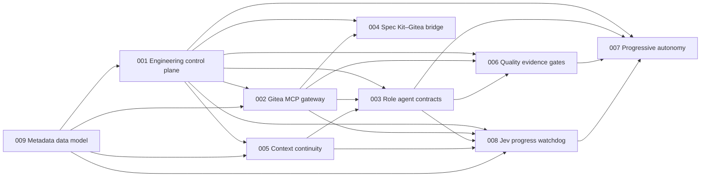

# Specifications: Agent Engineering Team

These are the specifications for an autonomous software-engineering organization. The constitution names three role agents, **Lead**, **PSE** and **Review**, that run in a LangGraph service over a Gitea 28.x control plane. **Jev**, the progress watchdog, watches their sessions. Spec 003 counts Jev as a fourth, watchdog role beside those three, with comment-and-label authority only, so the agent roles are exactly four (spec 003 FR-028; Jev's status as a role is inferred). **Smokey**, a person's account, approves promotion to the two highest autonomy modes. A shared metadata data model holds the records they all write and read. The specs are governed by the [constitution](../.specify/memory/constitution.md) (v1.1.0, Articles I–IX). They draw on the project intake [`agent-engineering-team`](../.specify/intakes/agent-engineering-team/intake.md) and the data-model intake [`metadata-data-model`](../.specify/intakes/metadata-data-model/intake.md).

Each folder is a Spec Kit feature: `spec.md` first, then `plan.md`, `tasks.md` and `checklists/` as phases run. Specs describe what and why. Technology appears only in a spec's Assumptions or where the person fixed it:

- Gitea 28.x (project intake Q1);
- a LangGraph service (Q2);
- SQLite with sqlite-vec plus a custom Python vector backend (Q9; data-model intake Q7);
- the OCaml, Rust and Python split (Q6, Q10);
- Claude and Ollama, cloud and local (Q7, Q14);
- the MacBook Pro M4 Pro host with about 18 GB usable (Q22; data-model intake Q14).

Shared record schemas live in spec [009](009-metadata-data-model/spec.md) and are exported to [`schemas/`](../schemas/) as versioned JSON Schema. Behavior specs reference them and never define a second copy.

## Index

The rows follow the build order. The Depends on and Unblocks columns match the fixed dependency map, and each spec's Dependencies section says what every edge consumes.

| Spec | Purpose | Depends on | Unblocks |
|---|---|---|---|
| [009-metadata-data-model](009-metadata-data-model/spec.md) | Foundation. One data model for people and agents: "One source of truth" (data-model intake Q1). It owns every shared record schema, exported for Python, OCaml and Rust. It puts a tenant id on every row, and only a record's owning role may change it. Related-knowledge search returns source and commit on every result and never shows a stale result. Search runs on SQLite with sqlite-vec and a custom Python vector backend behind one interface. It also covers the `git-history.md` feed for the knowledge graph and anonymizes removed people and agents. | — | 001, 002, 005, 008 |
| [001-engineering-control-plane](001-engineering-control-plane/spec.md) | Webhook gateway (HMAC-SHA256 verification, dedupe, normalization), an append-only event store with no time limit, a deterministic state machine and Kanban board, and the scheduler. Leases with TTL, heartbeat and epochs. Write-set conflict estimation and dependency unlock. The autonomy-mode gate and the capacity registry ("3 agent sessions + 6 subagents + the Jev agent.", project intake Q20). | 009 | 002, 003, 004, 005, 006, 007, 008 |
| [002-gitea-mcp-gateway](002-gitea-mcp-gateway/spec.md) | The only way agents touch Gitea. A narrow semantic tool surface with role authority and one Gitea bot account per role (project intake Q15). Every write carries the mutation envelope, with idempotency, optimistic concurrency and post-mutation verification. Jev gets comment-upsert and label-by-ID tools. There is no raw request tool and no force-merge tool. | 001, 009 | 003, 004, 006, 008 |
| [005-context-continuity](005-context-continuity/spec.md) | The repository knowledge layout and retrieval with provenance and staleness rejection. Session checkpoints, durable decision traces and optional visible reasoning chains. Lifecycle events, the command log, and `git-history.md`, rebuilt at session start and appended after every push. | 001, 009 | 003, 008 |
| [003-role-agent-contracts](003-role-agent-contracts/spec.md) | Lead, PSE and Review as operating contracts: mission, authoritative sources, permissions, invariants and required outputs. Evidence packages, review verdicts, escalation and arbitration. Subagent limits, and each role's duty to checkpoint, stop and escalate when stuck (project intake Q17–Q21). | 001, 002, 005 | 006, 007, 008 |
| [004-speckit-gitea-bridge](004-speckit-gitea-bridge/spec.md) | Spec Kit `tasks.md` → Gitea issues with dependencies, labels and board placement. A committed task-issue map, and reverse drift detection. | 001, 002 | — |
| [008-jev-progress-watchdog](008-jev-progress-watchdog/spec.md) | Jev, the read-mostly progress watchdog. It scans each session every 10 minutes for dead, hung and spinning states, and plain code decides the session's health. Escalation runs from a nudge to Lead to a person. Jev proposes the stop ladder. The session checkpoints and releases its lease, and the Lead carries out any hard stop, or the person does when the stuck session is the Lead's own (FR-029, FR-031). Jev parks a work item after 2 automatic restarts. It comments and labels only, through its own Gitea bot account. | 001, 002, 003, 005, 009 | 007 |
| [006-quality-evidence-gates](006-quality-evidence-gates/spec.md) | Verification layers, agent-behavior suites, evidence manifests, the merge evidence gate and risk-based escalation. | 001, 002, 003 | 007 |
| [007-progressive-autonomy](007-progressive-autonomy/spec.md) | Autonomy modes from Shadow to Self-improving, promotion criteria and the engineering scorecard, including Jev's progress metrics. Smokey is the sole approver of the two highest modes (project intake Q11–Q13). Cost per accepted issue informs Smokey and never blocks promotion by itself (Q23). | 001, 003, 006, 008 | — |

## Dependency map



An arrow points from a spec to a spec that depends on it. The 22 arrows are exactly the upstream edges in the fixed dependency map.

## Build order

```text
009 ──► 001 ──► 002, 005 ──► 003, 004 ──► 006, 008 ──► 007
```

1. **009** first. It owns the shared record schemas (events, leases, mutation envelopes, idempotency records, decision traces, session checkpoints, Jev messages and all other metadata) that 001, 002, 005 and 008 consume directly. Specs 003, 006 and 007 reach those records through their upstreams (spec 009, Dependencies; inferred), and spec 004 reaches the completeness-result schema through 001 (spec 004 FR-034; inferred).
2. **001** next. It consumes 009's schemas, and every later spec reads its events, leases, board states or capacity registry. 001 defines what is written to Gitea and 002 defines how. So 001's Gitea-writing requirements are built after 002, while event intake, the event store, the decision function and the lease service come first. Those requirements are FR-018, FR-020, FR-022, FR-025 and the executing side of FR-030 and FR-031. 002 is still not upstream of 001.
3. **002** and **005** in parallel.
   - The gateway needs 001's leases, idempotency store, per-issue version, transition table and capacity registry.
   - Continuity needs 001's leases, issue state and event store. From 009 it needs the checkpoint and trace schemas, the retrieval store and the `git-history.md` ingestion.
4. **003** and **004** in parallel.
   - Role contracts need the gateway (002) to enforce permissions through one bot account per role, and continuity (005) to resume.
   - The bridge needs the gateway to write issues.
5. **006** and **008** in parallel.
   - Evidence gates need role verdicts and evidence packages (003) and the gateway's check, review and merge-status tools (002).
   - Jev needs leases, events and the capacity registry (001), its bot account and comment-and-label tools (002), and the roles' stuck, checkpoint and stop duties (003). It also needs traces, checkpoints and the command log (005), and its message schema (009).
6. **007** last. Promotion criteria are measured on the scorecard that 003, 006 and 008 feed.

A first Jev scanner (`sdd-jev scan` in `packages/sdd-harness`) and `schemas/jev-message.v1.json` already exist ahead of their place in this order. Planning for 008 and 009 reconciles them with the specs (inferred).

## Shared vocabulary

| Term | Meaning | Defined in |
|---|---|---|
| Board state | Backlog, Ready for Spec, Specifying, Ready for Build, In Progress, Review, Changes Requested, Ready to Merge, Done; Blocked as an exceptional label | 001 |
| Normalized event | A verified, deduplicated Gitea webhook delivery in the schema-versioned event format, kept with no time limit ("Events have no time limit.", project intake Q16) | 001 (schema: 009) |
| Lease | An exclusive, expiring claim on one issue by one role and session, renewed by heartbeat and fenced by an epoch | 001 (schema: 009) |
| Mutation envelope | `actor_role`, `session_id`, `issue_id`, `expected_version`, `idempotency_key`, `reason` on every write | 001, 002 (schema: 009) |
| Evidence package | The PSE's machine-readable record of what was implemented and verified | 003 |
| Review verdict | `APPROVE`, `CHANGES_REQUESTED` or `BLOCKED_BY_ENV`, tied to the reviewed commit | 003 |
| Session checkpoint | The compact durable state a replacement session resumes from | 005 (schema: 009) |
| Decision trace | Decision, rationale summary, evidence, assumptions, tool results, changed state, unresolved questions, next action | 005 (schema: 009) |
| Quality gate manifest | The evidence manifest Review requires before `APPROVE` | 006 |
| Jev | The progress watchdog, "the Jev agent" in the peak capacity (project intake Q20). Every 10 minutes it reads each session's lease and session record, decision traces, checkpoints and command log, and for a PSE session its branch commits and head CI (spec 008 FR-005, FR-008). Plain code decides the session's health (ok, unknown, warn or stuck; Art. III). Jev nudges, comments, labels and proposes stops through its own Gitea bot account. It never edits code, pushes, approves or merges. The session checkpoints and releases its own lease, and the Lead carries out any hard stop, or the person does when the stuck session is the Lead's own, because the Lead never decides an escalation about itself (spec 008 FR-029, FR-031, inferred; Art. II). Jev is not Smokey (project intake Q12, inferred confirmation). | 008 (message schema: 009) |
| Smokey | A person's account, not an autonomous agent (project intake Q13), so Art. VI stands unchanged. Smokey is the sole approver of promotion to the Long-horizon and Self-improving modes: "Smokey should be the only one" (Q11; Q12: sole top-mode approver). | 007 |
| Stall episode | The bad scans of one session on one work item (spec 008 FR-026). It runs from the first bad scan until the session recovers, plus a one-scan hold. A dead, loop or timeout verdict can open it as stuck with no warning first (spec 008 FR-013, FR-016, FR-017). A relapse inside the hold reuses the same episode. Jev keys every comment and escalation step to the episode and edits that comment in place (Jev research report). | 008 |
| Durable progress | A push to the session's branch, a new checkpoint, a decision trace that records changed state, or a test or CI check that flips from failing to passing (spec 008 FR-009). Only durable progress resets Jev's bad-scan count. The 60-minute window without it is a default to calibrate (Jev research report). The specs read it as the "successful progress" of project intake Q17 (inferred). | 008 |
| Tenant | The organization, project and repository ids carried on every record ("Tenant id on every row", data-model intake Q6). A write without a full tenant is refused, and every search and write is scoped to one tenant. | 009 |
| Shared record schema | A versioned JSON Schema owned by spec 009 and exported to `schemas/`, which Python, OCaml and Rust all read. It covers events, leases, mutation envelopes, idempotency records, decision traces, session checkpoints, Jev messages and all other metadata. Behavior specs reference it and never define a second copy. | 009 |

## Open items carried from the intakes

Specs record these as Assumptions or `[NEEDS CLARIFICATION]` markers. After each phase, `/speckit-intake-refine` puts the person's open choices back to them.

**Still open in the project intake:**

- Which skill catalog the router indexes. The person deferred this as a to-do (Q8), and this repository is assumed to host it.
- Whether this GitHub-hosted repository is mirrored into the Gitea instance on the MacBook (Q1, Q22).
- How per-session isolation and lifecycle hooks map onto the LangGraph service (Q2).
- A headline success target with a number and a timeframe, for spec 007 (Q4).
- Who besides the owner may approve constitution amendments, and the time and budget for the first release.

**Planning risks from the data-model intake.** These are UNVERIFIED until tested, and they are feasibility questions, not the person's choices:

- Can sqlite-vec meet a p95 under 200 ms at 1 million chunks (Q4, Q7, Q8, Q14)?
- Does encryption at rest work with sqlite-vec loaded (Q7, Q25)?

**Resolved since the first pass:**

- implementation language (Q6, Q10);
- models (Q7, Q14; constitution v1.1.0);
- where Gitea and the service run (Q22: everything on the MacBook);
- expected scale (Q18, Q20; data-model intake Q8; issues per week and events per day remain planning estimates);
- control-plane storage (Q9, Q16; spec 009).
