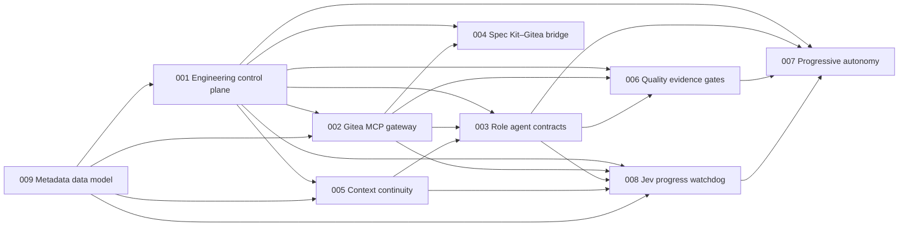

# Specifications: Agent Engineering Team

These are the specifications for an autonomous software-engineering organization. The constitution names three role agents, **Lead**, **PSE** and **Review**, that run in a LangGraph service over a Gitea 28.x control plane. Each role runs as one agent session, and at most one issue is in build at a time ("One per role (Recommended)", project intake R1). **Jev**, the progress watchdog, watches their sessions. Spec 003 counts Jev as a fourth, watchdog role beside those three, with comment-and-label authority only, so the agent roles are exactly four (spec 003 FR-028; Jev's status as a role is inferred). **Smokey**, a person's account, approves promotion to the two highest autonomy modes. A shared metadata data model holds the records they all write and read. The specs are governed by the [constitution](../.specify/memory/constitution.md) (v1.1.0, Articles I–IX). They draw on the project intake [`agent-engineering-team`](../.specify/intakes/agent-engineering-team/intake.md) and the data-model intake [`metadata-data-model`](../.specify/intakes/metadata-data-model/intake.md).

Each folder is a Spec Kit feature: `spec.md` first, then `plan.md`, `tasks.md` and `checklists/` as phases run. Specs describe what and why. Technology appears only in a spec's Assumptions or where the person fixed it:

- Gitea 28.x (project intake Q1);
- a LangGraph service (Q2);
- SQLite with sqlite-vec plus a custom Python vector backend (Q9; data-model intake Q7);
- the OCaml, Rust and Python split (Q6, Q10);
- Claude and Ollama, cloud and local (Q7, Q14);
- the MacBook Pro M4 Pro host with about 18 GB usable (Q22; data-model intake Q14).

Shared record schemas live in spec [009](009-metadata-data-model/spec.md) and are exported to [`schemas/`](../schemas/) as versioned JSON Schema. Behavior specs reference them and never define a second copy.

## Index

The rows follow the build order. The Depends on and Unblocks columns match the fixed dependency map, and each spec's Dependencies section says what every edge consumes.

| Spec | Purpose | Depends on | Unblocks |
|---|---|---|---|
| [009-metadata-data-model](009-metadata-data-model/spec.md) | Foundation. One data model for people and agents: "One source of truth" (data-model intake Q1). It owns every shared record schema, exported for Python, OCaml and Rust. It puts a tenant id on every row, and only a record's owning role may change it. Related-knowledge search returns source and commit on every result and never shows a stale result. Search runs on SQLite with sqlite-vec and a custom Python vector backend behind one interface. It also covers the `git-history.md` feed for the knowledge graph and anonymizes removed people and agents. | — | 001, 002, 005, 008 |
| [001-engineering-control-plane](001-engineering-control-plane/spec.md) | Webhook gateway (HMAC-SHA256 verification, dedupe, normalization), an append-only event store with no time limit, a deterministic state machine and Kanban board, and the scheduler. Leases with TTL, heartbeat and epochs, fenced in two places as the person chose ("Both", project intake R7): the coordination layer refuses writes and lease checks that carry an older epoch (FR-032), and a `lease-epoch` commit status that branch protection requires keeps a commit from a stale epoch from ever merging (FR-038). That the control plane judges each agent-branch head and posts the status is inferred. Dependency unlock, and write-set conflict estimation, which only orders queued work (FR-023; inferred from R1). The autonomy-mode gate and the capacity registry ("3 agent sessions + 6 subagents + the Jev agent.", project intake Q20), divided "One per role (Recommended)": one session each for Lead, PSE and Review, at most one issue in build at a time (R1; FR-035). | 009 | 002, 003, 004, 005, 006, 007, 008 |
| [002-gitea-mcp-gateway](002-gitea-mcp-gateway/spec.md) | The only way agents and the control plane's System actor call Gitea's API (Art. III). Sessions push commits with git under branch protection, outside the gateway (spec 002 Assumptions), which is why R7 adds the forge-side `lease-epoch` fence. A narrow semantic tool surface with role authority and one Gitea bot account per role (project intake Q15). Every write carries the mutation envelope, with idempotency, optimistic concurrency and post-mutation verification. Read-only issue search and milestone lookup, which a person approved ("Approve read-only search (Recommended)", project intake R4). In Shadow mode it refuses every Gitea write by Lead, PSE, Review and the System actor, except the entries of a bridge plan a person approved (R3; FR-024, FR-037). Jev's comment-and-label writes are not refused in any mode (FR-024; inferred). Jev gets comment-upsert and label-by-ID tools for its 12 `jev/` labels (R8). One narrow tool, limited to the System row, posts the `lease-epoch` status and no other status context (R7; FR-038; the tool's name, its row placement and its single-context limit are inferred; treating R7 as the tool's approval is inferred). There is no raw request tool and no force-merge tool. | 001, 009 | 003, 004, 006, 008 |
| [005-context-continuity](005-context-continuity/spec.md) | The repository knowledge layout and retrieval with provenance and staleness rejection. Session checkpoints, durable decision traces and optional visible reasoning chains. Lifecycle events, the command log, and `git-history.md`, rebuilt at session start and appended after every push. | 001, 009 | 003, 008 |
| [003-role-agent-contracts](003-role-agent-contracts/spec.md) | Lead, PSE and Review as operating contracts: mission, authoritative sources, permissions, invariants and required outputs. Evidence packages, review verdicts, escalation and arbitration. Subagent limits, and each role's duty to checkpoint, stop and escalate when stuck (project intake Q17–Q21). One session per role (R1). Lead writes code only under an implementation-worker grant that the owner approves per issue ("Owner, per issue (Recommended)", project intake R2). Every commit made under a write lease records that lease's epoch, so the `lease-epoch` status can judge it (FR-039; R7 fixes only the two fences; that each commit records its epoch, and the form, such as a commit trailer, are inferred from the person's "Both"). | 001, 002, 005 | 006, 007, 008 |
| [004-speckit-gitea-bridge](004-speckit-gitea-bridge/spec.md) | Spec Kit `tasks.md` → Gitea issues with dependencies, labels and board placement. A committed task-issue map, and reverse drift detection. In Shadow mode the bridge writes nothing on its own and produces a dry-run plan. A person applies it either way, "Both Create issues by hand and Approve; gateway writes it" (project intake R3): by creating the issues by hand, or by approving the plan, after which a later run sends exactly the approved writes through the gateway (FR-023; spec 002 FR-037). It finds existing issues and milestones through the gateway's read-only issue search and milestone lookup, which a person approved (R4). | 001, 002 | — |
| [008-jev-progress-watchdog](008-jev-progress-watchdog/spec.md) | Jev, the read-mostly progress watchdog. It scans each session every 10 minutes for dead, hung and spinning states, and plain code decides the session's health. A session is spinning after 60 minutes without durable progress, for every role; per-role values are proposed from scan history later and take effect only when a person approves them ("60 min, per role later (Recommended)", project intake R6; FR-015). Escalation runs from a nudge to Lead to a person. Jev proposes the stop ladder. The session checkpoints and releases its lease, and the Lead carries out any hard stop, or the person does when the stuck session is the Lead's own (FR-029, FR-031). Lease expiry and spec 001's two epoch fences are the backstop ("Both", R7; FR-029 step 5). Jev parks a work item after 2 automatic restarts. It comments and labels only, through its own Gitea bot account, and never posts a commit status. Each role's session has its own label showing its latest verdict, and a summary label shows the most severe open episode on the work item ("Role labels + summary (Recommended)", R8; FR-036). | 001, 002, 003, 005, 009 | 007 |
| [006-quality-evidence-gates](006-quality-evidence-gates/spec.md) | Verification layers, agent-behavior suites, evidence manifests, the merge evidence gate and risk-based escalation. Branch protection on `main` requires the merge evidence gate and, once a person adds it, the `lease-epoch` status (FR-013; project intake R7). | 001, 002, 003 | 007 |
| [007-progressive-autonomy](007-progressive-autonomy/spec.md) | Autonomy modes from Shadow to Self-improving, promotion criteria and the engineering scorecard, including Jev's progress metrics. Smokey is the sole approver of the two highest modes (project intake Q11–Q13). Cost per accepted issue informs Smokey and never blocks promotion by itself (Q23). In Shadow mode a person may approve the bridge's plan for the gateway to write (R3; FR-002). The headline target: accepted issues per week rise by at least 30% within 3 months of reaching Guarded autonomous mode, compared with the Shadow-mode baseline, at the fixed capacity of "3 agent sessions + 6 subagents + the Jev agent" (Q20), while escaped defects, revert rate, security incidents and human recovery cost stay no worse than their Shadow-mode baselines ("+30% in 3 months (Recommended)", R5; SC-004). | 001, 003, 006, 008 | — |

## Dependency map



An arrow points from a spec to a spec that depends on it. The 22 arrows are exactly the upstream edges in the fixed dependency map.

## Build order

```text
009 ──► 001 ──► 002, 005 ──► 003, 004 ──► 006, 008 ──► 007
```

1. **009** first. It owns the shared record schemas (events, leases, mutation envelopes, idempotency records, decision traces, session checkpoints, Jev messages and all other metadata) that 001, 002, 005 and 008 consume directly. Specs 003, 006 and 007 reach those records through their upstreams (spec 009, Dependencies; inferred), and spec 004 reaches the completeness-result schema through 001 (spec 004 FR-034; inferred).
2. **001** next. It consumes 009's schemas, and every later spec reads its events, leases, board states or capacity registry. 001 defines what is written to Gitea and 002 defines how. So 001's Gitea-writing requirements are built after 002, while event intake, the event store, the decision function and the lease service come first. Those requirements are FR-018, FR-020, FR-022, FR-025, FR-038 (posting the `lease-epoch` status) and the executing side of FR-030 and FR-031. 002 is still not upstream of 001.
3. **002** and **005** in parallel.
   - The gateway needs 001's leases, idempotency store, per-issue version, transition table and capacity registry, and the System actor whose `lease-epoch` status it carries (001 FR-031, FR-038).
   - Continuity needs 001's leases, issue state and event store. From 009 it needs the checkpoint and trace schemas, the retrieval store and the `git-history.md` ingestion.
4. **003** and **004** in parallel.
   - Role contracts need the gateway (002) to enforce permissions through one bot account per role, and continuity (005) to resume.
   - The bridge needs the gateway to write issues.
5. **006** and **008** in parallel.
   - Evidence gates need role verdicts and evidence packages (003) and the gateway's check, review and merge-status tools (002).
   - Jev needs leases, events, the capacity registry and the two epoch fences behind its stop ladder's backstop (001 FR-032, FR-038), and its bot account and comment-and-label tools for the 12 `jev/` labels (002). It needs the roles' stuck, checkpoint and stop duties (003). It also needs traces, checkpoints and the command log (005), and its message schema (009).
6. **007** last. Promotion criteria are measured on the scorecard that 003, 006 and 008 feed. The headline target (SC-004; project intake R5) is measured at the fixed capacity and the one-session-per-role division that 001 enforces (001 FR-021, FR-035).

A first Jev scanner (`sdd-jev scan` in `packages/sdd-harness`) and `schemas/jev-message.v1.json` already exist ahead of their place in this order. Planning for 008 and 009 reconciles them with the specs (inferred). For example, the scanner applies only the three summary labels so far, and spec 008 FR-036 adds the nine role labels (project intake R8).

## Shared vocabulary

| Term | Meaning | Defined in |
|---|---|---|
| Board state | Backlog, Ready for Spec, Specifying, Ready for Build, In Progress, Review, Changes Requested, Ready to Merge, Done; Blocked as an exceptional label | 001 |
| Normalized event | A verified, deduplicated Gitea webhook delivery in the schema-versioned event format, kept with no time limit ("Events have no time limit.", project intake Q16) | 001 (schema: 009) |
| Lease | An exclusive, expiring claim on one issue, or on one part of an issue Lead partitioned, by one role and session, renewed by heartbeat and fenced by an epoch in two places ("Both", project intake R7): the coordination layer refuses a write or lease check that carries an older epoch, and the required `lease-epoch` status keeps a commit from a stale epoch from merging | 001 (schema: 009) |
| Lease-epoch status | The commit status `lease-epoch` that branch protection requires, so a commit from a stale epoch can never merge (project intake R7). The rest is inferred. The control plane, as the System actor with its own Gitea bot account (001 FR-031), judges each new head of an agent branch by the lease epoch the commit records, for example in a commit trailer the session writes. It posts failure when that epoch is missing or older than the current epoch of the issue or part (fail closed, Art. IV) and success otherwise. It posts through one narrow gateway tool limited to the System row and to that one status context. A person adds `lease-epoch` to branch protection's required checks (Art. VI). Jev never posts a status and gains no new right from the fence. | 001 (tool: 002) |
| Capacity | "3 agent sessions + 6 subagents + the Jev agent." (project intake Q20), divided "One per role (Recommended)": one session each for Lead, PSE and Review, at most one issue in build at a time (R1). "At most 2 subagents per container, per role and per Gitea bot account." (Q18). A dispatch or session start beyond the Q20 capacity or its R1 division is held as WAIT with the reason "capacity" (spec 001 FR-021, FR-035; WAIT is inferred). A subagent beyond the Q18 cap is refused (spec 001 FR-034) | 001 |
| Mutation envelope | `actor_role`, `session_id`, `issue_id`, `expected_version`, `idempotency_key`, `reason` on every write | 001, 002 (schema: 009) |
| Evidence package | The PSE's machine-readable record of what was implemented and verified | 003 |
| Review verdict | `APPROVE`, `CHANGES_REQUESTED` or `BLOCKED_BY_ENV`, tied to the reviewed commit | 003 |
| Session checkpoint | The compact durable state a replacement session resumes from | 005 (schema: 009) |
| Decision trace | Decision, rationale summary, evidence, assumptions, tool results, changed state, unresolved questions, next action | 005 (schema: 009) |
| Quality gate manifest | The evidence manifest Review requires before `APPROVE` | 006 |
| Jev | The progress watchdog, "the Jev agent" in the peak capacity (project intake Q20). Every 10 minutes it reads each session's lease and session record, decision traces, checkpoints and command log, and for a session that holds a write lease (the PSE, or Lead under an implementation-worker grant the owner approves per issue, R2) its branch commits and head CI (spec 008 FR-005, FR-008). Plain code decides the session's health (ok, unknown, warn or stuck; Art. III). Jev nudges, comments, labels and proposes stops through its own Gitea bot account. It never edits code, pushes, approves, merges or posts a commit status. The session checkpoints and releases its own lease, and the Lead carries out any hard stop, or the person does when the stuck session is the Lead's own, because the Lead never decides an escalation about itself (spec 008 FR-029, FR-031, inferred; Art. II). Jev is not Smokey (project intake Q12, inferred confirmation). | 008 (message schema: 009) |
| Jev labels | 12 exclusive, scoped labels that a person creates once ("Role labels + summary (Recommended)", project intake R8). The role labels `jev/lead/warning`, `jev/lead/stuck`, `jev/lead/parked`, `jev/pse/warning`, `jev/pse/stuck`, `jev/pse/parked`, `jev/review/warning`, `jev/review/stuck` and `jev/review/parked` show each role's session's latest verdict. The summary label `jev/warning`, `jev/stuck` or `jev/parked` shows the most severe open episode across the supervised sessions on the work item (parked, then stuck, then warning; the order is inferred). Gitea v28.2.0 takes an exclusive label's scope from the part of its name before the last `/` (`models/issues/label.go`, `ExclusiveScope`), so each role's three labels replace each other, and a role label and the summary label never replace each other. When an episode closes, its role label is removed and the summary is recomputed from the remaining open episodes, or removed when none remain. Parked labels, the role's and the summary's, stay until a person resets them. How the labels follow episodes (removal on close, recomputing the summary, parked labels staying) is inferred (spec 008 FR-036). Jev's write permission stays "labels in the jev/ scope". | 008 (gateway scope: 002) |
| Smokey | A person's account, not an autonomous agent (project intake Q13), so Art. VI stands unchanged. Smokey is the sole approver of promotion to the Long-horizon and Self-improving modes: "Smokey should be the only one" (Q11; Q12: sole top-mode approver). | 007 |
| Stall episode | The bad scans of one session on one work item (spec 008 FR-026). It runs from the first bad scan until the session recovers, plus a one-scan hold. A dead, loop or timeout verdict can open it as stuck with no warning first (spec 008 FR-013, FR-016, FR-017). A relapse inside the hold reuses the same episode. Jev keys every comment and escalation step to the episode and edits that comment in place (Jev research report). While the episode is open, its session's role label shows its latest verdict (project intake R8; that the label stays for the whole episode is inferred, spec 008 FR-036). | 008 |
| Durable progress | A push to the session's branch, a new checkpoint, a decision trace that records changed state, or a test or CI check that flips from failing to passing (spec 008 FR-009). Only durable progress resets Jev's bad-scan count. A session that shows none for 60 minutes is spinning. The person set "60 min, per role later (Recommended)": 60 minutes for every role now; after the first weeks of scan history, values per role (Lead, PSE, Review) are proposed from that history and a person approves the change (project intake R6; spec 008 FR-015, FR-048), because thresholds are rules (Art. VI). The specs read durable progress as the "successful progress" of project intake Q17 (inferred). | 008 |
| Tenant | The organization, project and repository ids carried on every record ("Tenant id on every row", data-model intake Q6). A write without a full tenant is refused, and every search and write is scoped to one tenant. | 009 |
| Shared record schema | A versioned JSON Schema owned by spec 009 and exported to `schemas/`, which Python, OCaml and Rust all read. It covers events, leases, mutation envelopes, idempotency records, decision traces, session checkpoints, Jev messages and all other metadata. Behavior specs reference it and never define a second copy. | 009 |

## Open and settled items

These come from the intakes and from the Specify-phase refinement. Specs record open ones as Assumptions or `[NEEDS CLARIFICATION]` markers. After each phase, `/speckit-intake-refine` puts the person's open choices back to them.

**Still open in the project intake:**

- Which skill catalog the router indexes. The person deferred this as a to-do (Q8), and this repository is assumed to host it.
- Whether this GitHub-hosted repository is mirrored into the Gitea instance on the MacBook (Q1, Q22).
- How per-session isolation and lifecycle hooks map onto the LangGraph service (Q2).
- Who besides the owner may approve constitution amendments, and the time and budget for the first release.

**Settled by the Specify-phase refinement** (project intake, Phase Refinements, Specify · 2026-10-22):

- R1: "One per role (Recommended)" — one session each for Lead, PSE and Review; at most one issue in build at a time (spec 001 FR-035). Write-set serialization therefore only orders queued work (spec 001 FR-023; inferred from R1).
- R2: "Owner, per issue (Recommended)" — a person (the owner) approves each switch of Lead into implementation-worker mode, per issue (spec 003 FR-010).
- R3: "Both Create issues by hand and Approve; gateway writes it" — in Shadow mode a person applies the bridge's dry-run plan by hand, or approves it and the gateway carries it out as a human-approved write (spec 004 FR-022, FR-023; spec 002 FR-037; this changes spec 002 FR-024 and spec 007 FR-002).
- R4: "Approve read-only search (Recommended)" — the gateway gains read-only issue search and milestone lookup (spec 002 FR-001; spec 004 FR-024).
- R5: "+30% in 3 months (Recommended)" — the headline target with a number and a timeframe that Q4 left open (spec 007 SC-004).
- R6: "60 min, per role later (Recommended)" — the durable-progress window (spec 008 FR-015, FR-048).
- R7: "Both" — the coordination-layer fence and a required `lease-epoch` commit status (spec 001 FR-032, FR-038; spec 002 FR-038; spec 008 FR-029 step 5). Who judges and posts the status, that each commit records its epoch and how it does so, the failure rule (fail closed on a missing or older epoch), and the gateway tool's name, System-only placement and single-context limit are inferred. The specs take the person's answer as the human approval the new tool needs (spec 002 FR-003) (inferred; goes back to the person in the next refine round).
- R8: "All three", confirmed in a follow-up as "Role labels + summary (Recommended)" — nine role labels and three summary labels, 12 in all, which a person creates once (spec 008 FR-036; spec 002 FR-027, FR-034).

**Open in the specs after that refinement.** These are `[NEEDS CLARIFICATION]` markers for the next `/speckit-intake-refine` round. Both lease-epoch fences are settled (R7). What stays open is how work that no agent write lease covers reaches a branch and a pull request and meets the required check:

- How a pull request from a branch a person pushed meets the required `lease-epoch` check, including every pull request in Shadow mode, where no write lease is granted (inferred). Its commits record no lease epoch, and the control plane posts the status only on agent-branch heads. One answer settles spec 001 FR-038, spec 002 FR-038 and spec 006 FR-013.
- How Review's regression tests reach the protected branch, since Review holds no write lease and its commits record no epoch (spec 003 FR-020).
- How the Lead's specification commits, such as the bridge's mapping commit, reach a branch and a pull request (spec 004 FR-027).

**Planning risks from the data-model intake.** These are UNVERIFIED until tested, and they are feasibility questions, not the person's choices:

- Can sqlite-vec meet a p95 under 200 ms at 1 million chunks (Q4, Q7, Q8, Q14)?
- Does encryption at rest work with sqlite-vec loaded (Q7, Q25)?

**Resolved since the first pass:**

- implementation language (Q6, Q10);
- models (Q7, Q14; constitution v1.1.0);
- where Gitea and the service run (Q22: everything on the MacBook);
- expected scale (Q18, Q20; data-model intake Q8; issues per week and events per day remain planning estimates), with the 3 agent sessions divided one per role (R1);
- control-plane storage (Q9, Q16; spec 009);
- the headline success target (Q4), set by R5 (spec 007 SC-004).
