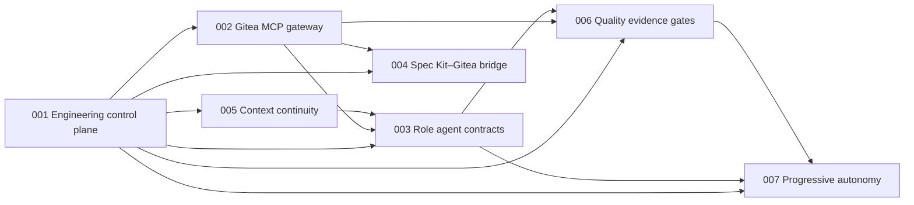

# Specifications: Agent Engineering Team

Specifications for an autonomous software-engineering organization of three role agents — **Lead**, **PSE** and **Review** — running in a LangGraph service over a Gitea 28.x control plane, governed by the [constitution](../.specify/memory/constitution.md) and drawn from the project intake [`agent-engineering-team`](../.specify/intakes/agent-engineering-team/intake.md).

Each folder is a Spec Kit feature (`spec.md`, then `plan.md`, `tasks.md`, `checklists/` as phases run). Specs describe what and why; technology appears only where the owner fixed it (Gitea 28.x, LangGraph service) or in a spec's Assumptions.

## Index

| Spec | Purpose | Depends on | Unblocks |
|---|---|---|---|
| [001-engineering-control-plane](001-engineering-control-plane/spec.md) | Foundation. Webhook gateway (HMAC-SHA256 verification, dedupe, normalization), append-only event store, deterministic state machine and Kanban board, scheduler, leases with TTL and heartbeat, write-set conflict estimation, dependency unlock. | — | 002, 003, 004, 005, 006, 007 |
| [002-gitea-mcp-gateway](002-gitea-mcp-gateway/spec.md) | The only way agents touch Gitea: a narrow semantic tool surface with role authority, mutation envelope, idempotency, optimistic concurrency and post-mutation verification. No raw request or force-merge tool. | 001 | 003, 004, 006 |
| [003-role-agent-contracts](003-role-agent-contracts/spec.md) | Lead, PSE and Review as operating contracts (mission, authoritative sources, permissions, invariants, required outputs) with evidence packages, review verdicts, escalation and arbitration. | 001, 002, 005 | 006, 007 |
| [004-speckit-gitea-bridge](004-speckit-gitea-bridge/spec.md) | Spec Kit `tasks.md` → Gitea issues with dependencies, labels and board placement, a committed task-issue map, and reverse drift detection. | 001, 002 | — |
| [005-context-continuity](005-context-continuity/spec.md) | Repository knowledge layout, derived retrieval index with provenance and staleness rejection, session checkpoints, durable decision traces and optional visible reasoning chains. | 001 | 003 |
| [006-quality-evidence-gates](006-quality-evidence-gates/spec.md) | Verification layers, agent-behavior suites, evidence manifests, the merge evidence gate and risk-based escalation. | 001, 002, 003 | 007 |
| [007-progressive-autonomy](007-progressive-autonomy/spec.md) | Autonomy modes from Shadow to Self-improving, promotion criteria and the engineering scorecard. | 001, 003, 006 | — |

## Dependency map



An arrow points from a spec to a spec that depends on it.

## Build order

```text
001 ──► 002, 005 ──► 003, 004 ──► 006 ──► 007
```

1. **001** first: every other spec reads its events, leases, board states or mutation envelope.
2. **002** and **005** in parallel: the gateway needs 001's leases and idempotency store; continuity needs 001's event and lease records for checkpoints.
3. **003** and **004** in parallel: role contracts need the gateway (002) to enforce permissions and continuity (005) to resume; the bridge needs the gateway to write issues.
4. **006**: evidence gates need role verdicts (003) and the gateway's merge-status tools (002).
5. **007** last: promotion criteria are measured on the scorecard that 006 and 003 produce.

## Shared vocabulary

| Term | Meaning | Defined in |
|---|---|---|
| Board state | Backlog, Ready for Spec, Specifying, Ready for Build, In Progress, Review, Changes Requested, Ready to Merge, Done; Blocked as an exceptional label | 001 |
| Normalized event | A verified, deduplicated Gitea webhook delivery in the schema-versioned event format | 001 |
| Lease | An exclusive, expiring claim on one issue by one role and session | 001 |
| Mutation envelope | `actor_role`, `session_id`, `issue_id`, `expected_version`, `idempotency_key`, `reason` on every write | 001, 002 |
| Evidence package | The PSE's machine-readable record of what was implemented and verified | 003 |
| Review verdict | `APPROVE`, `CHANGES_REQUESTED` or `BLOCKED_BY_ENV`, tied to the reviewed commit | 003 |
| Session checkpoint | The compact durable state a replacement session resumes from | 005 |
| Decision trace | Decision, rationale summary, evidence, assumptions, tool results, changed state, unresolved questions, next action | 005 |
| Quality gate manifest | The evidence manifest Review requires before `APPROVE` | 006 |

## Open items carried from the project intake

These are unresolved owner decisions; specs record them as assumptions or `[NEEDS CLARIFICATION]` markers and `/speckit-intake-refine` puts them back to the owner after each phase.

- Implementation language (Python 3.12+ assumed), model and embeddings (`claude-opus-5-5` with offline hybrid retrieval assumed), skill catalog location (this repository assumed).
- Where the Gitea 28.x instance runs and how the LangGraph service reaches it.
- How the report's per-session worktree isolation and lifecycle hooks map onto the LangGraph service.
- Headline success targets, expected scale, control-plane storage, amendment approvers, time and budget.
